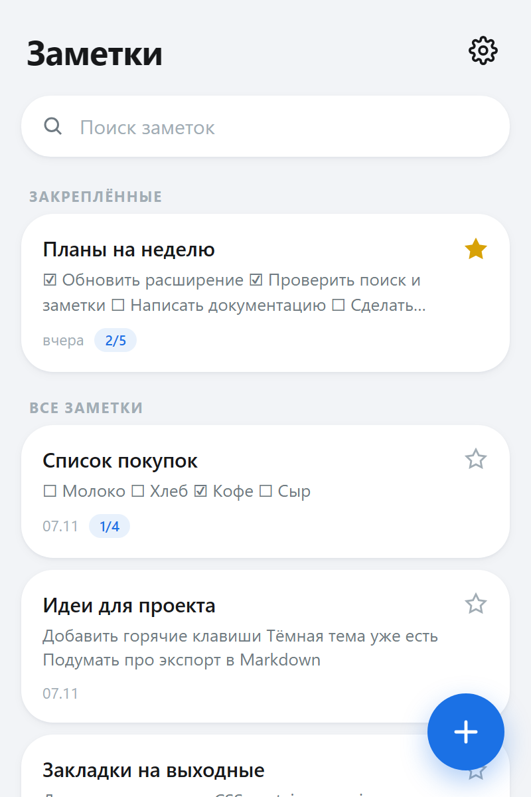
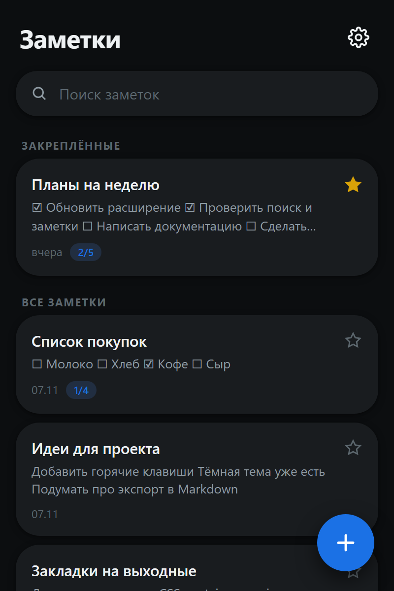
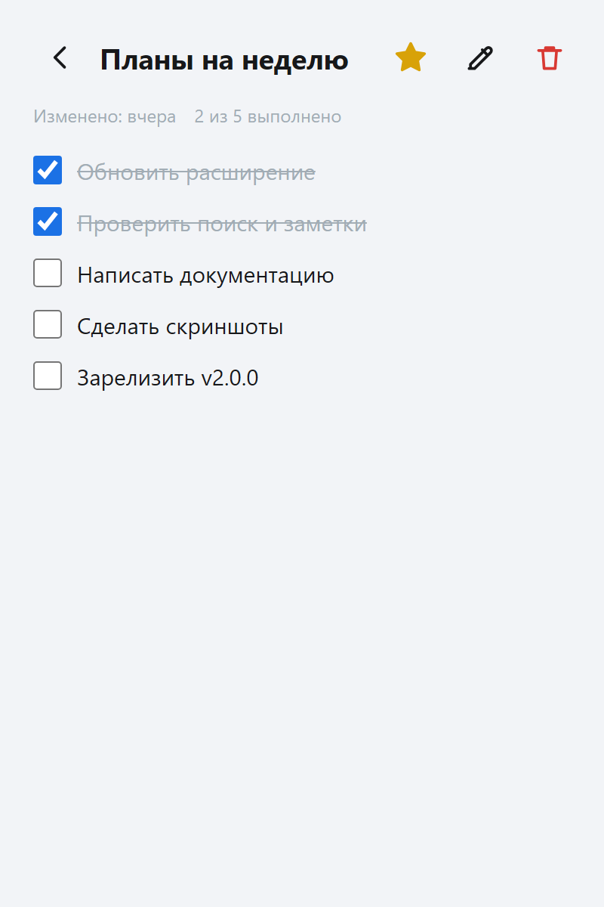
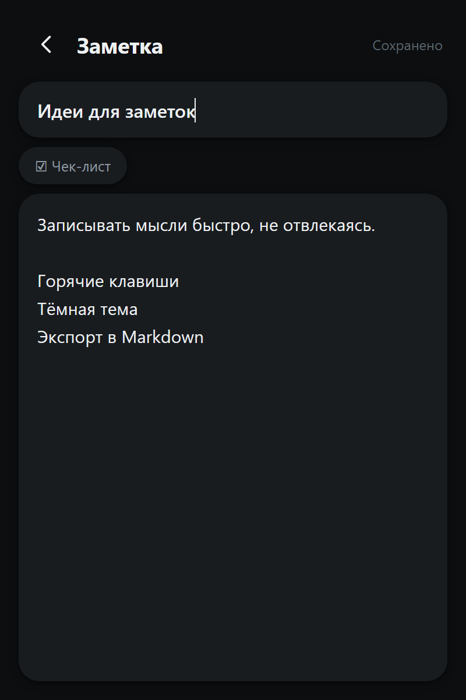
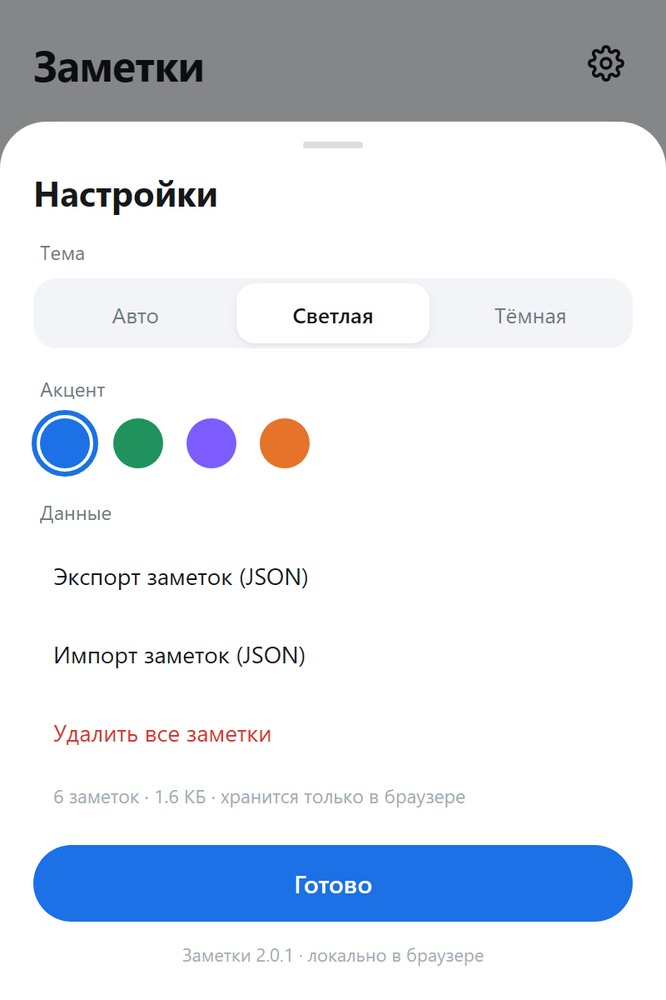

# add-ons-notes — локальные заметки в браузере (в стиле One UI)

Расширение для Chromium (Manifest V3): быстрые заметки прямо в браузере.
Без серверов, без аккаунтов, без внешних приложений — всё хранится локально
в браузере (`chrome.storage.local`).

## Возможности

- создание, редактирование и удаление заметок (автосохранение при вводе);
- **чек-листы**: строка `- [ ]` превращается в интерактивную галочку в просмотре;
- закрепление важных заметок (★ — всегда сверху);
- живой поиск по заголовку и тексту;
- компактный просмотр с прогрессом чек-листа (например, «3/5»);
- экспорт/импорт всех заметок в JSON (перенос между браузерами/переустановка);
- тема: авто / светлая / тёмная; акцент: синий, зелёный, фиолетовый, оранжевый;
- интерфейс по мотивам One UI: крупные заголовки, карточки, скругления, FAB.

## Скриншоты

| Светлая тема | Тёмная тема |
|---|---|
|  |  |

| Заметка с чек-листом | Редактор |
|---|---|
|  |  |



## Установка

📦 **Скачать:** [Releases](https://github.com/Souzn1k3/add-ons-notes/releases)
— архив `add-ons-notes-v2.0.1.zip`, распаковать и загрузить папку
(где `manifest.json`) как распакованное расширение.

Подробная инструкция для Samsung Internet / Chrome / Edge:
**[INSTALL.md](INSTALL.md)**.

Кратко:

1. Открой страницу расширений браузера:
   - Chrome/Edge/Brave: `chrome://extensions` → включи «Режим разработчика» →
     «Загрузить распакованное» → папка `extension/`;
   - Samsung Internet: меню → Add-ons → «Developer mode» → «Load Unpacked» →
     папка `extension/`.
2. Закрепи иконку на панели и пользуйся.

Обновление после изменений кода: на странице Add-ons нажать «Update»
(или удалить и загрузить папку заново).

## Где хранятся данные

Только в профиле браузера: `chrome.storage.local`, ключ `nb_notes_v1`.
Никаких сетевых запросов расширение не делает — в манифесте нет
`host_permissions`. Резервная копия — кнопка «Экспорт» в настройках.

## Структура

```
extension/
  manifest.json        MV3, права: только storage
  icons/               иконки (генерируются tools/gen_icons.py)
  popup/
    popup.html         экраны: список, просмотр, редактор, настройки
    popup.css          One UI стили
    tokens.css         дизайн-токены (темы, акценты)
    popup.js           логика приложения
    store.js           локальное хранилище, экспорт/импорт
    util.js            чек-листы, даты, сортировка
tools/
  gen_icons.py         генератор иконок (чистый Python)
docs/
  design-references.md референсы One UI
```

## Разработка

- JS без сборки: модули ES, проверка синтаксиса `node --check`.
- Тесты чистой логики: `npm test` (Node 18+; чек-листы, импорт, очередь записи).
- История и теги — в git; актуальный релиз отмечен тегом `v2.0.1`.

## Trademark

Интерфейс вдохновлён One UI, но не содержит ассетов, шрифтов и логотипов
Samsung. Проект не связан с Samsung Electronics. One UI — продукт Samsung;
название используется только как описание стиля.

## Лицензия

[MIT](LICENSE) © 2026 Souzn1k3
